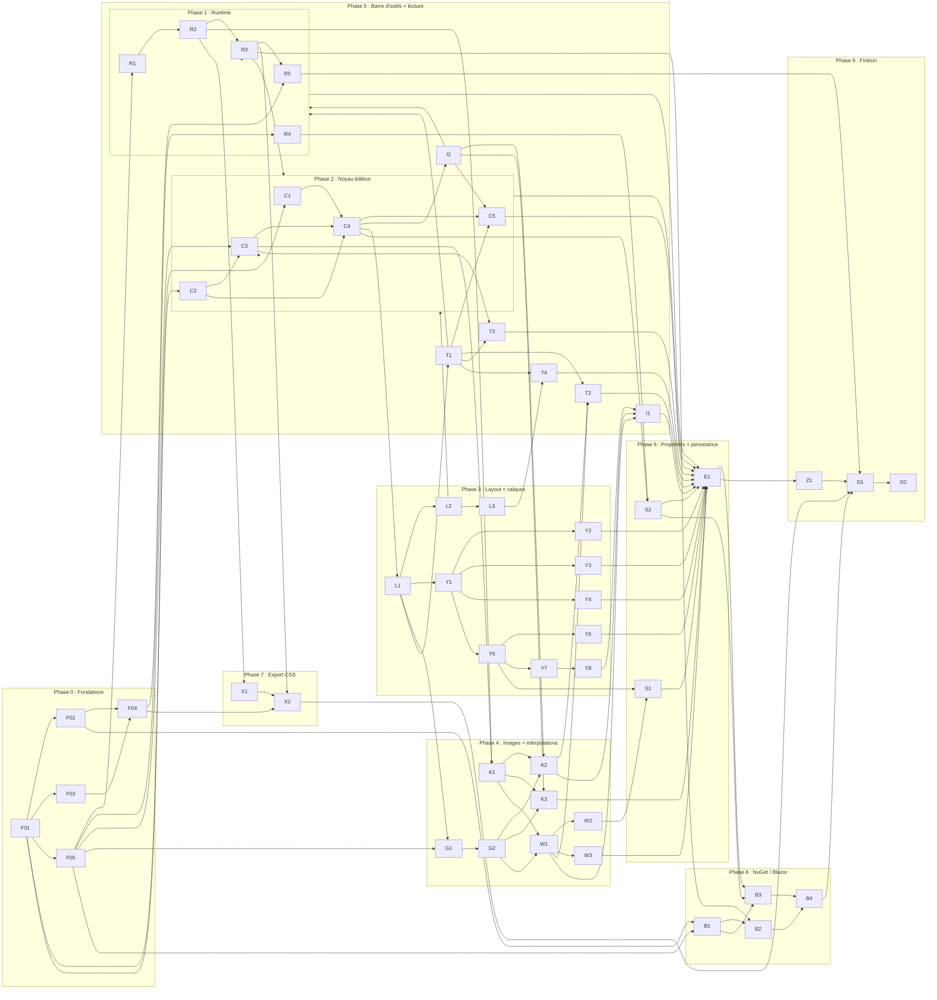

# Plan d'intégration v2

Ce plan découpe la v2 (voir [rapport-analyse.md](rapport-analyse.md)) en **54 tâches** avec leurs dépendances, pour pouvoir les répartir entre plusieurs sessions de travail en parallèle.

## Branches

| Branche | Rôle |
|---|---|
| `main` | Inchangée pour l'instant. Reçoit `v2/base` à la sortie de la 1.0.0. |
| `v1/original` | Sauvegarde figée de l'état du projet avant la v2 (commit `8e64b14`). On n'y pousse plus rien. |
| `v2/base` | **Branche d'intégration.** Toutes les tâches partent d'elle et y reviennent par pull request. |
| `v2/<ID>-<court-nom>` | Une branche par tâche, par exemple `v2/R3-player-waapi`. |

## Règles pour travailler en parallèle

1. **Une session = une tâche = une branche = une pull request** vers `v2/base`.
2. Une tâche ne démarre que quand **toutes** ses dépendances sont fusionnées dans `v2/base`. La colonne « Vague » donne le plus tôt possible.
3. Chaque tâche ne touche que **sa zone de fichiers**. Si elle doit modifier la zone d'une autre, elle le dit dans sa pull request et attend que l'autre soit fusionnée.
4. Les tâches marquées **Contrat** (F05, C1, C2) fixent des interfaces que tout le monde utilise. Après leur fusion, toute modification de ces interfaces passe par sa propre petite pull request, et les tâches en cours se mettent à jour à partir de `v2/base`.
5. Une pull request n'est fusionnée que si la CI est verte : lint, Jest, build et Playwright (à partir de F04).
6. Le code de `packages/editor/src/legacy` reste fonctionnel jusqu'à Z1. On **reprend** sa logique dans les nouveaux plugins, on ne le modifie pas.
7. Chaque nouveau fichier `.ts` commence par son chemin depuis la racine et, pour un plugin, par l'en-tête décrit dans le rapport (section 4.4). Le test de F03 le vérifie.
8. Toute modification du document passe par une commande annulable (`CommandStack`) ; les tests de chaque commande vérifient aussi son annulation.
9. La pull request coche la case « Fait » de sa ligne dans ce fichier.

## Vagues de démarrage

Toutes les tâches d'une même vague peuvent tourner en parallèle, dès que leurs dépendances sont fusionnées.

| Vague | Tâches qui peuvent démarrer en parallèle |
|---|---|
| 0 | F01 |
| 1 | F02, F03, F05, C1, C2 |
| 2 | F04, R1, R4, C3, B1 |
| 3 | R2, C4 |
| 4 | R3, I2, L1, K1, S2, X1 |
| 5 | R5, L2, Y1, G1, T1, X2, B2 |
| 6 | C5, L3, Y2, Y3, Y4, Y5, G2, T3, P1, P2 |
| 7 | Y6, Y7, K2, K3, W1, T4 |
| 8 | Y8, W2, W3, T2 |
| 9 | I1, S1 |
| 10 | E1 |
| 11 | B3, Z1 |
| 12 | B4 |
| 13 | D1 |
| 14 | D2 |

**Chemin critique** (la plus longue chaîne de dépendances, à prioriser) :
F01 → C2 → C3 → C4 → L1 → Y1 → Y5 → Y7 → Y8 → I1 → E1 → B3 → B4 → D1 → D2

## Liste des tâches

« Vague » = le plus tôt où la tâche peut démarrer. « Débloque » = les tâches qui attendent celle-ci.

| ID | Phase | Vague | Tâche | Dépend de | Débloque | Zone de fichiers | Fait |
|---|---|---|---|---|---|---|---|
| **F01** | 0 | 0 | Squelette monorepo (npm workspaces), code actuel déplacé tel quel dans `packages/editor/src/legacy`, tests Jest toujours verts | — | F02, F03, F05, C1, C2 | racine, `packages/editor/src/legacy/` | ☑ |
| **F02** | 0 | 1 | Build Vite en mode librairie par package (ESM + UMD + `.d.ts`, sans hash), champ `exports` correct | F01 | F04, B1 | `vite.config.*`, `package.json` des packages | ☑ |
| **F03** | 0 | 1 | ESLint (`no-explicit-any`, en avertissement pour `legacy/`) + test de conventions (en-tête de chemin, dépendances d'en-tête = `dependencies`) | F01 | F04 | `.eslintrc`, `tools/conventions/` | ☑ |
| **F04** | 0 | 2 | CI GitHub Actions (Node 22) : lint, Jest, build, Playwright Chromium + test « la démo s'affiche » | F02, F03 | R5, X2 | `.github/workflows/`, `e2e/` | ☑ |
| **F05** | 0 | 1 | **Contrat** : schéma JSON v2 (`schema/timeline.schema.json`) + types TS du modèle dans `runtime` | F01 | R1, R4, C3, G1, B1 | `schema/`, `packages/runtime/src/model/` | ☑ |
| **R1** | 1 | 2 | Registre de propriétés + propriétés intégrées (x, y, rotation, scaleX/Y, skewX/Y, opacity) + composition `transform` à ordre fixe | F05 | R2 | `packages/runtime/src/properties/` | ☐ |
| **R2** | 1 | 3 | Évaluation : valeur de chaque propriété à l'image N (plages, pistes, accélérations, valeurs par défaut, plage vide) | R1 | R3, K1, X1 | `packages/runtime/src/evaluate/` | ☐ |
| **R3** | 1 | 4 | Lecteur Web Animations : construction des images clés, échantillonnage des accélérations, play/pause/seek/loop/speed, événements, `update`, `destroy` | R2 | R5, P1, P2, X2, B2 | `packages/runtime/src/player/` | ☐ |
| **R4** | 1 | 2 | Migrateur v1 → v2 | F05 | S2 | `packages/runtime/src/migrate/` | ☐ |
| **R5** | 1 | 5 | Démo du `runtime` + scénario Playwright 11 (lecture, pause, boucle, `complete`) | R3, F04 | D1 | `demo/runtime/`, `e2e/runtime/` | ☐ |
| **C1** | 2 | 1 | **Contrat** : `IPlugin` + `PluginHost` (tri topologique, erreurs de dépendance, epics parents, emplacements de rendu) | F01 | C4 | `packages/editor/src/core/plugin/` | ☐ |
| **C2** | 2 | 1 | **Contrat** : `EventBus` typé (`TimelineEventMap` extensible, événements annulables) | F01 | C3, C4 | `packages/editor/src/core/events/` | ☑ |
| **C3** | 2 | 2 | `Store` (document v2) + `CommandStack` (do/undo, regroupement pendant un glisser, plafond) | C2, F05 | C4, K1, T3, P2 | `packages/editor/src/core/store/`, `core/commands/` | ☐ |
| **C4** | 2 | 3 | `EditorContext` + `createEditor()` (jeu de plugins par défaut, plugins optionnels, `destroy`) | C1, C2, C3 | C5, I2, L1, S2 | `packages/editor/src/core/`, `src/index.ts` | ☐ |
| **C5** | 2 | 6 | Plugin `history.undoRedo` (boutons + Ctrl+Z / Ctrl+Y) | C4, T1, I2 | E1 | `plugins/history/` | ☐ |
| **I2** | 5 | 4 | Plugin `interaction.shortcuts` : registre de raccourcis où chaque plugin déclare les siens | C4 | C5, K2, K3, P1 | `plugins/interaction/shortcuts/` | ☐ |
| **L1** | 3 | 4 | Plugin `layout.shell` (4 zones + emplacements) + `layout.scrollSync` (repris de `legacy`) | C4 | L2, Y1, G1, T1 | `plugins/layout/shell/`, `layout/scrollSync/` | ☐ |
| **L2** | 3 | 5 | Plugins `layout.ruler` + `layout.playhead` (repris de `TimeRuler`) | L1 | L3, P2 | `plugins/layout/ruler/`, `layout/playhead/` | ☐ |
| **L3** | 3 | 6 | Plugin `layout.zoom` (largeur d'image variable, événement `zoom:changed`) | L2 | T4 | `plugins/layout/zoom/` | ☐ |
| **Y1** | 3 | 5 | Plugin `layers.list` : arbre des calques **avec une API d'emplacements de contrôles par ligne** (pour que Y2 à Y4 travaillent en parallèle) | L1 | Y2, Y3, Y4, Y5 | `plugins/layers/list/` | ☐ |
| **Y2** | 3 | 6 | Plugins `layers.rename`, `layers.visibility`, `layers.lock` (commandes + contrôles de ligne) | Y1 | E1 | `plugins/layers/rename|visibility|lock/` | ☐ |
| **Y3** | 3 | 6 | Plugins `layers.color` + `layers.icon` | Y1 | E1 | `plugins/layers/color|icon/` | ☐ |
| **Y4** | 3 | 6 | Plugin `layers.target` (sélecteur CSS ou élément) | Y1 | E1 | `plugins/layers/target/` | ☐ |
| **Y5** | 3 | 6 | Plugin `layers.selection` (sélection multiple Ctrl / Maj) | Y1 | Y6, Y7, S1 | `plugins/layers/selection/` | ☐ |
| **Y6** | 3 | 7 | Plugin `layers.reorder` (glisser-déposer, entrer/sortir d'un dossier) | Y5 | E1 | `plugins/layers/reorder/` | ☐ |
| **Y7** | 3 | 7 | Plugin `layers.groups` (dossiers + « grouper la sélection ») | Y5 | Y8 | `plugins/layers/groups/` | ☐ |
| **Y8** | 3 | 8 | Plugin `layers.toolbar` (Nouveau / Grouper / Supprimer) | Y7 | I1 | `plugins/layers/toolbar/` | ☐ |
| **G1** | 4 | 5 | Plugin `frames.grid` : rendu des plages (statique, vide, interpolation, losanges), écoute `zoom:changed` | L1, F05 | G2 | `plugins/frames/grid/` | ☐ |
| **G2** | 4 | 6 | Plugin `frames.selection` (images et images clés, Ctrl / Maj, repris de `SelectionManager`) | G1 | K2, K3, W1 | `plugins/frames/selection/` | ☐ |
| **K1** | 4 | 4 | **Cœur CS4** : opérations pures sur les plages (insérer une image clé avec valeurs interpolées, supprimer/fusionner, insérer/supprimer une image, déplacer) + refus si verrouillé, sous forme de commandes | C3, R2 | K2, K3, W1 | `packages/editor/src/model/spans/` | ☐ |
| **K2** | 4 | 7 | Plugin `frames.keyframes` (F5 / F6 / F7, glisser pour déplacer) | K1, G2, I2 | T2, I1 | `plugins/frames/keyframes/` | ☐ |
| **K3** | 4 | 7 | Plugin `frames.clipboard` (Ctrl+C / Ctrl+V) | K1, G2, I2 | E1 | `plugins/frames/clipboard/` | ☐ |
| **W1** | 4 | 7 | Plugin `tweens.motion` : créer un motion tween depuis 1 ou 2 images clés, le supprimer | K1, G2 | W2, W3, T2, I1 | `plugins/tweens/motion/` | ☐ |
| **W2** | 4 | 8 | Plugin `tweens.propertyKeyframes` + API `editor.setProperty()` (crée les losanges) | W1 | S1 | `plugins/tweens/propertyKeyframes/` | ☐ |
| **W3** | 4 | 8 | Plugin `tweens.easing` (préréglages, remplace `TweenPropertiesDialog`) | W1 | E1 | `plugins/tweens/easing/` | ☐ |
| **T1** | 5 | 5 | Plugin `toolbar.main` (zone « Scene 1 », API d'ajout de boutons) | L1 | C5, T2, T3, T4, P1 | `plugins/toolbar/main/` | ☐ |
| **T2** | 5 | 8 | Plugin `toolbar.keyframeActions` (les 4 boutons du cahier) | T1, K2, W1 | E1 | `plugins/toolbar/keyframeActions/` | ☐ |
| **T3** | 5 | 6 | Plugin `toolbar.timeSettings` (fps et durée, en commandes) | T1, C3 | E1 | `plugins/toolbar/timeSettings/` | ☐ |
| **T4** | 5 | 7 | Plugin `toolbar.zoomControl` (liste déroulante + curseur) | T1, L3 | E1 | `plugins/toolbar/zoomControl/` | ☐ |
| **P1** | 5 | 6 | Plugin `playback.controls` (lecture, pause, boucle, vitesse via le `runtime`) | T1, R3, I2 | E1 | `plugins/playback/controls/` | ☐ |
| **P2** | 5 | 6 | Plugin `playback.livePreview` (tête de lecture → `player.seek`, modification → `player.update`) | R3, L2, C3 | E1 | `plugins/playback/livePreview/` | ☐ |
| **I1** | 5 | 9 | Plugin `interaction.contextMenu` (repris, actions branchées sur les commandes) | K2, W1, Y8 | E1 | `plugins/interaction/contextMenu/` | ☐ |
| **S1** | 6 | 9 | Plugin optionnel `properties.panel` | W2, Y5 | E1 | `plugins/properties/panel/` | ☐ |
| **S2** | 6 | 4 | Plugin `persistence.json` (import/export, lecture des fichiers v1 via le migrateur) | C4, R4 | E1, B3 | `plugins/persistence/` | ☐ |
| **E1** | 6 | 10 | Démo de l'éditeur v2 + scénarios Playwright 1 à 10 | T2, T3, T4, P1, P2, C5, Y2, Y3, Y4, Y6, K3, W3, I1, S1, S2 | B3, Z1 | `demo/editor/`, `e2e/editor/` | ☐ |
| **X1** | 7 | 4 | Package `export-css` (`@keyframes` + avertissements) | R2 | X2 | `packages/export-css/` | ☐ |
| **X2** | 7 | 5 | Scénario Playwright 12 (CSS exporté = `runtime` à l'image N) | X1, R3, F04 | D1 | `e2e/export-css/` | ☐ |
| **B1** | 8 | 2 | Razor Class Library : squelette, copie des builds dans `wwwroot`, modèle C# généré depuis le schéma | F02, F05 | B2, B3 | `dotnet/` | ☐ |
| **B2** | 8 | 5 | Composant Blazor `TimelinePlayer` | B1, R3 | B4 | `dotnet/JsTimeline.Blazor/Player/` | ☐ |
| **B3** | 8 | 11 | Composant Blazor `TimelineEditor` (liaison des données, callbacks d'événements) | B1, S2, E1 | B4 | `dotnet/JsTimeline.Blazor/Editor/` | ☐ |
| **B4** | 8 | 12 | Appli Blazor d'exemple + tests bUnit + `dotnet pack` en CI | B2, B3 | D1 | `dotnet/samples/`, `dotnet/*.Tests/` | ☐ |
| **Z1** | 9 | 11 | Suppression de `packages/editor/src/legacy` et de l'ancienne démo | E1 | D1 | `packages/editor/src/legacy/` | ☐ |
| **D1** | 9 | 13 | README réécrit (CS4, nouvelle API), doc d'API, démo GitHub Pages | Z1, X2, B4, R5 | D2 | `README.md`, `doc/`, `demo/` | ☐ |
| **D2** | 9 | 14 | Publication 1.0.0 sur tag (npm + NuGet) | D1 | — | `.github/workflows/release.yml` | ☐ |

## Graphe des dépendances

## Correspondance avec les scénarios Playwright du rapport

| Scénario | Tâche qui l'écrit |
|---|---|
| 1 à 10 (éditeur) | E1, chaque plugin ajoutant au fur et à mesure ses propres tests dans `e2e/editor/` |
| 11 (`runtime` seul) | R5 |
| 12 (cohérence export CSS / `runtime`) | X2 |

## Définition de « fait » pour une tâche

- Le code respecte les consignes du projet (un fichier par fonctionnalité, en-tête de chemin, dépendances déclarées, communication par événements, chaque plugin rend son propre contenu).
- Tests Jest de la logique (et de l'annulation pour les commandes).
- Tests Playwright pour toute interaction visible à l'écran.
- Aucun `any` dans le nouveau code.
- La CI est verte et la case « Fait » est cochée.
